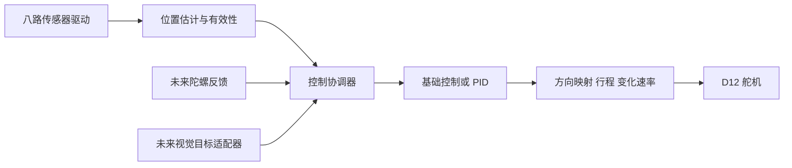

# 基础巡线反向响应与后续控制接口

集成在正常 `esp32dev` 固件中，使用车头八路数字巡线模块和 GPIO12 舵机。
默认关闭自动转向，上电不绑定舵机 PWM；明确开启后才接入。
电调油门仍由网页/遥控命令管理，巡线开启本身不发前进油门。

## 当前基础功能

已确认从车尾往车头看 CH1 在左侧。按本次要求，基础控制先实现**相对胶带偏差的反向响应**，
PWM 对应的实际前轮左右方向暂未标定，默认 direction=+1，可在关闭时用 `@D -1` 翻转。

默认工作表（中位 1500us、方向 +1）：

| 胶带命中位置 | 位置偏差 | 基础模式的最终目标 PWM |
|---|---|---|
| CH1～CH3 一侧，偏差超过居中区 | 负（左侧） | 1540us |
| CH4/CH5 附近 | 接近 0 | 1500us |
| CH6～CH8 一侧，偏差超过居中区 | 正（右侧） | 1460us |

这是通道偏差到 PWM 的映射，1540/1460 是否对应实际右/左转需要静止测试。
本次先验证传感器—舵机响应；实际行驶要以车辆能回到胶带上为准，不能仅靠“反向”字面确定正确反馈方向。

偏差超过 0.22 时进入固定 ±40us 转向；偏差回到 0.16 以内时回中。
两个阈值构成滞回，避免在边界频繁切换。CH4、CH5 单独命中的偏差约 ±0.143，都在回中区。
转向采用原有 150us/s 的速率限制，所以到达 ±40us 约需 0.27s，回中也受此限制。
丢线、故障和关闭时立即回中。基础响应在油门中位时也运行，可以先静止观察，不需给前进油门。

根据先前上传的实际扫线 CSV，黑线原始 HIGH 位呈现完整的 CH1→CH8→CH1 往返，因此本版本
`line_sensor.h` 默认 `LINE_LEVEL=HIGH`；启动会打印 `[LINE_POLARITY] black=HIGH`。
先用 L 验证亮灯位置与 line=1 一致，完成后 R 再 N1。如果重新实测表明黑线 raw=0，
修改该常量为 LOW 并重新烧录，不能用反转舵机方向补偿错误的传感器极性。

## 架构分层



- `line_sensor.*`：采集、通道选择、原始电平和命中掩码，不控制舵机。
- `line_position.*`：将一帧转换为 `LinePosition`，包含中心、归一化偏差、有效状态、序号和时间戳；不做控制。丢线、全命中和多个分离线段有明确状态。
- `line_controller.*`：`LineController` 的 `reset/compute` 算法接口；`BasicLineController` 使用固定偏转与滞回，`PIDLineController` 使用现有 PID。算法不访问 GPIO、串口或电调。
- `automatic_steering.*`：管理模式、反馈时间、新帧去重、故障、转向方向和速率限制，选择算法，将它的 PWM 增量交给执行器。
- `steering_control.*`：D12 PWM、机械中位和行程，集中管理硬件输出；`esc_control.*` 保留动力控制与故障互锁。

控制算法输入的 `correctionError=-LinePosition.normalizedError` 是本次要求的反向响应约定。
`@D` 是其后的 PWM 方向标定，不参与传感器位置计算。新增闭环算法可以实现同一 `LineController` 接口并在协调器选择，
无须复制传感器驱动、串口解析、舵机限位或丢线保护。若后续使用摄像头地面位置，需编写有效性/单位适配器；图像角不能直接充当角速度。

## PID 与采样

每个新巡线帧计算命中通道的加权中心：CH1 权重 -3.5，CH8 权重 +3.5，
平均后除以 3.5，得到 -1～1 的偏差。CH1 左侧为负，CH8 右侧为正。
重复缓存帧不会重复积分。控制周期取帧完成时间差，通常约 10ms。

`feedback_pid.h` 在 demo 的位置式 PID 思路上增加了显式 dt、测量微分、
30ms 微分低通、条件积分和非有限值校验。舵机输出饱和、尚未跟上变化速率或没有前进油门时，
不继续积累积分；停车、模式切换和故障会清除相关状态。
PID 算法保留 Kp=35 us/归一化偏差、Ki=0、Kd=0，**默认不使用 PID**；关闭后 `@C 1` 选择，再 N1。
PWM 保持 50Hz，不能把软件控制计算频率理解为舵机机械响应频率。

未标定时输出范围1200～1800μs，中位1500μs；手动面板可将实际直行位置保存为新中位，断电保留，保存后范围为新中位±300μs。连续控制的变化速率上限为150μs/s。
急停、故障和关闭模式立即回中，不受该速率限制。

## 开启入口

在项目根目录烧录正常固件（替换实际串口）：

```powershell
pio run -d PIO_RotationmitCamera -e esp32dev -t upload --upload-port COM12
```

重启 Orange Pi 网页后台并刷新。线控底盘驱动台有“开启巡线转向”和“关闭巡线并归中”。
先归中油门，确保巡线模块对准单条线，再开启；页面以 `[FOLLOW]` 固件反馈确认实际状态。
固件只在电调实际输出中位、无遥控接管、无急停保护且反馈有效时允许开启。
开启后清除旧油门/增速，需要新的油门命令才运行。
第一版只支持前进；网页“输出”和“增速”的数值不等同于闭环恒速。

也可关闭占用串口的后台，使用串口监视器：

```powershell
pio device monitor -p COM12 -b 115200 --filter send_on_enter
```

| 指令（回车发送） | 功能 |
|---|---|
| `N1` | 切回正常数据模式并开启巡线转向 |
| `N0` | 关闭自动转向、舵机回中、电调回中并解除巡线故障锁定 |
| `@C 0` | 选择基础反向响应（默认），关闭陀螺仪内环 |
| `@C 1` | 选择 PID 算法，关闭陀螺仪内环 |
| `@F 40,0.22,0.16` | 设置基础模式固定偏转 us、进入阈值、退出阈值 |
| `@P 35,0,0` | 设置巡线 Kp、Ki、Kd；只在关闭/故障状态接受 |
| `@D 1` / `@D -1` | 设置转向输出方向；只在关闭/故障状态接受 |
| `@W 1450,1500,1550` | 设置最小、中位、最大 PWM，见下面的行程限制 |
| `@S` | 查询当前转向状态及原因 |
| `E` | 保留最高优先级急停，同时关闭自动转向 |
| `L/G/V/R` | 保留原模块功能，先退出自动转向；R 不会自动重启巡线 |

C/F/P/D/W/H/Q 参数只在关闭或故障状态接受；F 要求 0<偏转≤200us、0≤退出阈值<进入阈值<1，
最终输出仍会被舵机机械行程限位。`@C` 参数包与 V 模式的单字符 C 归中命令不同。

最小静态验证流程：

```text
R
N0
@C 0
@F 40,0.22,0.16
@D 1
N1
```

每行回车发送；保持油门 1500，将黑胶带分别放到左侧、中间、右侧看前轮和 `[FOLLOW]`。
如果与所需方向相反，依次 `N0`、`@D -1`、`N1`。网页原“开启巡线转向”按钮也使用当前算法，
状态会显示 BASIC/PID/GYRO 和方向；每次复位默认 BASIC、direction=+1。

新参数包以 `@` 开头，长度小于 64 字节，100ms 内发送完整行，使用普通十进制数。
不要使用带 e/E 的科学计数法，因为 E 始终作为立即急停处理。
现有 T/B 油门、L/G 巡线调试、V 舵机调试及 R 恢复上报没有改成 demo 的其他含义。
正常巡线控制持续发送 `[ENC]` 和 `[LINE]`，可以同时记录车速和压力。
`[FOLLOW]` 每 200ms 至多上报一次，UART 不足时跳过，不等待发送。新增 `algo=BASIC/PID/GYRO` 和 `dir=+/-1` 字段。
偏差 e 表示胶带位置，不是舵机输出方向；pwm 是经过速率限制后的实际指令。

## 网页命令确认与不动作排查

网页新版本发送 `N1,<请求编号>`，ESP32 返回 `[FOLLOW_ACK] id=... action=1 ok=0/1 ...`。
旧的单独 `N1/N0` 串口命令继续支持。确认包含 raw、命中 mask、黑线电平 lvl 和拒绝原因，
UART 缓冲区忙时会在后续循环重试发送确认，不阻塞控制。状态在 OFF 模式也持续上报，
避免拒绝开启后网页收不到状态。

HTTP 写串口成功只表示“命令已发送”。网页会显示固件成功/拒绝确认，3秒无确认则明确报超时，
旧请求的迟到确认不会被当作新请求成功。更新这版须同时烧录新版 esp32dev 和同步 Orange Pi 的
`Camera_mit_Rotation_dashboard.py`、`steering_requests.py`、`static/js/main.js`、`templates/index.html`，重启后台、强制刷新网页。
关闭命令同时包含旧格式 N0，让尚未更新的旧固件也能停止；新编号格式的开启命令需要新版固件。

| 页面结果 | 排查方向 |
|---|---|
| 未检测到黑胶带 | 看 raw、line 与实际亮灯位置；确认探头高度和当前 HIGH/LOW 极性 |
| 全通道/多段命中 | 检查是否胶带遮住全排、探头方向或极性解释错误 |
| 尚无完整帧 | 检查启动 LINE_ERROR、接线和传感器初始化 |
| PWM 初始化失败 | 检查舵机输出是否成功绑定 |
| 3秒未收到确认 | 检查是否烧录了这版正常固件、是否有其他串口工具占用、后台是否仍接收串口 |
| 已开启，偏差接近0，PWM=1500 | 当前胶带在居中区，不转是预期结果；移到 CH1～CH3 或 CH6～CH8 一侧观察 |
| 已开启，PWM 已到1460/1540，但前轮不动 | 用 V/J/K 独立验证舵机，检查 D12 信号、舵机供电与共地；这是执行端排查 |

固件仅重试发送确认/状态，不重试执行转向开启命令。仍保留手动明确重新开启和故障动力锁定。

## 故障与接管

- 没有命中、全部八路命中、出现多个分离线段：停止动力并锁定，舵机回中。
- 巡线帧超过 100ms 未更新或控制采样间隔过长：同样锁定，不自动恢复旧油门。
- 收到倒车油门：第一版停止并锁定，避免使用前进的转向方向关系。
- 找回线后必须明确输入 N1/点击开启重启，或 N0/关闭按钮解除并退出。
- 遥控油门接管：退出自动转向并回中，保留已有遥控油门功能。
  当前尚未接入遥控转向信号，不能把“遥控油门接管”理解为已能遥控舵机。
- 网页急停在原来的反向制动过程前发送 N0，先关闭自动转向；串口 E 仍按原急停逻辑处理。

先架空测试，把目标线依次放在左侧、中央、右侧，观察偏差、PWM 与前轮方向。
方向相反时先 N0，再设置 @D -1，重新 N1。当前行程很小，需要实测能否完成转弯。
调整行程须先确认机械中位与极限。@W 的范围只接受 1000～2000 us、
中位 1400～1600 us，且最小<中位<最大。**改变左右限位只能在本次启动尚未绑定舵机之前操作**，
即复位后先 @W，再 V 或 N1；绑定后不在运行中重新绑定 PWM。
中位可在关闭/故障状态微调，但也必须在已绑定的左右限位内部。
设置只保存在 RAM，复位恢复默认；需要固化时修改 `include/steering_control.h`。

## 已预留接口

`automatic_steering.h` 提供：

```cpp
// MPU6050 驱动以后每次新采样提交，方向统一为车身右转为正。
submitYawRateFeedback(yawDegPerSec, sampleTimeMs, sensorValid);
// 摄像头或遥控转向适配器以后提交期望角速度，右转为正。
submitTargetYawRate(targetDegPerSec, receivedTimeMs, targetValid);
```

时间戳必须来自 ESP32 millis()，有效标记必须来自真实读取结果。错误读取不能用 0 假装正常；
反馈超时 100ms、外部目标超时 250ms，都会停止并锁定。
陀螺仪接口不初始化 I2C、不读取硬件、不使用未经确认的 GPIO26 遥控转向接线。
Orange Pi 摄像头以后须共享现有后台串口，不能启动另一个进程抢占串口。

后续的 `@H 1` 可为巡线启用角速度内环，`@H 0` 恢复当前基础/PID 算法；
`@Q 1,0,0` 设置内环增益。没有新鲜陀螺仪反馈时拒绝 @H 1。
`@Y 10` 提交外部目标 10 deg/s，`N2` 请求外部角速度控制模式；没有有效反馈和目标时拒绝 N2。
已经加入 [M 模式 MPU6050 硬件测试驱动](mpu6050_debug.md)，但它仅在调试模式采样，尚未向控制反馈接口提交数据；因此正常使用 N1 即可，H1/N2 不会凭空生效。
预留内环默认 Kp=1、Ki=Kd=0，尚未完成物理调参。
角速度内环只在前进油门超过 1550us 时运行，该判断是油门请求而非实际车速；
以后仍需加入车速、倒车方向、转角标定和采样频率验证，才能用于高速稳定控制。

## 验证范围

主机 C++ 测试编译实际 PID、巡线控制、串口、舵机和 ESC 源码，用模拟传感器/串口验证
方向、速率限制、积分饱和、重复帧、丢线/歧义、超时锁定、RC 接管、急停与后续反馈接口。
两种 ESP32 固件编译通过不代表实车已经能稳定巡线；增益、传感器极性、左右方向和机械行程须实测。
